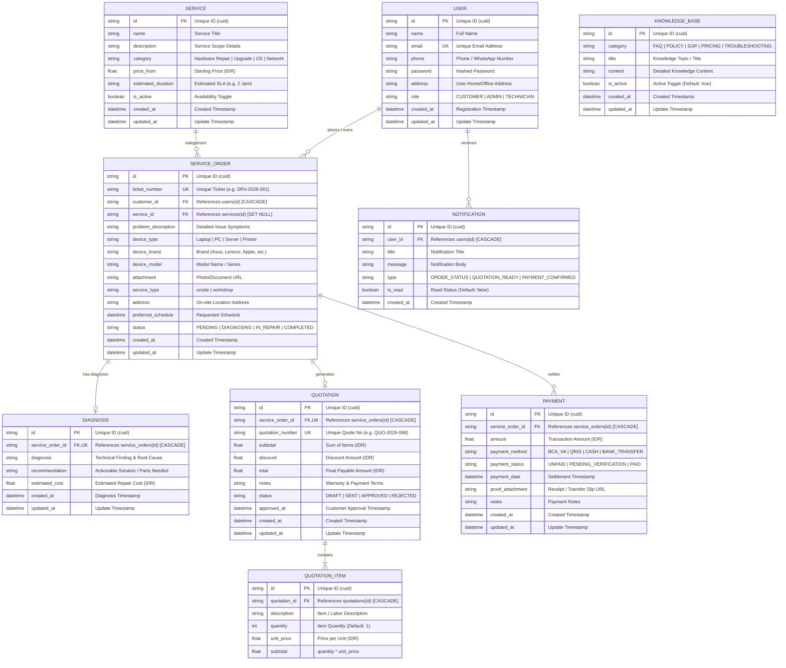

# 🗄️ Database Documentation - IT Service Business System

Dokumentasi lengkap desain basis data, model entitas (*Entity Data Model*), kamus data (*Data Dictionary*), aturan relasi *foreign key*, dan diagram keterhubungan (ERD) untuk **IT Service Business System**.

---

## 1. Entity-Relationship Diagram (ERD)



---

## 2. Kamus Data (*Data Dictionary*)

### 1. Tabel `users`
Menyimpan data otentikasi dan profil pengguna (Customer, Administrator, dan Teknisi).

| Nama Kolom | Tipe Data | Nullable | Default | Keterangan & Aturan |
| :--- | :--- | :---: | :---: | :--- |
| `id` | `VARCHAR(30)` | ❌ | `cuid()` | **Primary Key** |
| `name` | `VARCHAR(255)` | ❌ | - | Nama lengkap pengguna |
| `email` | `VARCHAR(255)` | ❌ | - | **Unique Index**, alamat email aktif |
| `phone` | `VARCHAR(30)` | ✅ | `NULL` | Nomor HP / WhatsApp kontak |
| `password` | `VARCHAR(255)` | ✅ | `NULL` | Hash password otentikasi |
| `address` | `TEXT` | ✅ | `NULL` | Alamat lengkap domisili / kantor |
| `role` | `VARCHAR(20)` | ❌ | `'CUSTOMER'` | Nilai: `CUSTOMER`, `ADMIN`, `TECHNICIAN` |
| `created_at` | `DATETIME` | ❌ | `CURRENT_TIMESTAMP` | Waktu registrasi |
| `updated_at` | `DATETIME` | ❌ | *Auto-updated* | Waktu pembaruan profil |

---

### 2. Tabel `services`
Menyimpan katalog master layanan jasa IT dan perbaikan hardware komputer.

| Nama Kolom | Tipe Data | Nullable | Default | Keterangan & Aturan |
| :--- | :--- | :---: | :---: | :--- |
| `id` | `VARCHAR(30)` | ❌ | `cuid()` | **Primary Key** |
| `name` | `VARCHAR(255)` | ❌ | - | Judul layanan (e.g. *Hardware Diagnostics*) |
| `description` | `TEXT` | ❌ | - | Penjelasan ruang lingkup layanan |
| `category` | `VARCHAR(100)` | ❌ | - | Kategori: `Hardware Repair`, `Hardware Upgrade`, `OS & Software`, `Network`, `Data Recovery` |
| `price_from` | `DOUBLE` | ❌ | - | Biaya dasar terendah (IDR) |
| `estimated_duration`| `VARCHAR(100)` | ❌ | - | Estimasi durasi pengerjaan (SLA) |
| `is_active` | `BOOLEAN` | ❌ | `true` | Status ketersediaan layanan |
| `created_at` | `DATETIME` | ❌ | `CURRENT_TIMESTAMP` | Waktu pembuatan data |
| `updated_at` | `DATETIME` | ❌ | *Auto-updated* | Waktu update data |

---

### 3. Tabel `service_orders`
Menyimpan tiket pemesanan servis (*service booking*), data unit perangkat, keluhan, jenis penanganan, dan status pengerjaan.

| Nama Kolom | Tipe Data | Nullable | Default | Keterangan & Aturan |
| :--- | :--- | :---: | :---: | :--- |
| `id` | `VARCHAR(30)` | ❌ | `cuid()` | **Primary Key** |
| `ticket_number` | `VARCHAR(50)` | ❌ | - | **Unique Index**, No. Tiket Pelacakan (e.g. `SRV-2026-001`) |
| `customer_id` | `VARCHAR(30)` | ❌ | - | **Foreign Key** -> `users(id)` [ON DELETE CASCADE] |
| `service_id` | `VARCHAR(30)` | ✅ | `NULL` | **Foreign Key** -> `services(id)` [ON DELETE SET NULL] |
| `problem_description`| `TEXT` | ❌ | - | Deskripsi gejala kerusakan oleh customer |
| `device_type` | `VARCHAR(50)` | ❌ | - | Jenis perangkat: `Laptop`, `PC Desktop`, `Server/Network`, `Printer/Peripheral` |
| `device_brand` | `VARCHAR(100)` | ❌ | - | Merk perangkat (e.g. Asus, Lenovo, Apple) |
| `device_model` | `VARCHAR(100)` | ❌ | - | Seri/Model spesifik unit |
| `attachment` | `VARCHAR(255)` | ✅ | `NULL` | URL lampiran foto fisik/dokumen |
| `service_type` | `VARCHAR(20)` | ❌ | `'workshop'` | Penanganan: `onsite` atau `workshop` |
| `address` | `TEXT` | ✅ | `NULL` | Alamat kedatangan teknisi (wajib jika onsite) |
| `preferred_schedule`| `DATETIME` | ✅ | `NULL` | Jadwal kunjungan/penyerahan yang diinginkan |
| `status` | `VARCHAR(30)` | ❌ | `'PENDING'` | `PENDING`, `DIAGNOSING`, `QUOTED`, `IN_REPAIR`, `READY_FOR_PICKUP`, `COMPLETED`, `CANCELLED` |
| `created_at` | `DATETIME` | ❌ | `CURRENT_TIMESTAMP` | Waktu submit order |
| `updated_at` | `DATETIME` | ❌ | *Auto-updated* | Waktu update status |

---

### 4. Tabel `diagnoses`
Menyimpan hasil pemeriksaan mendalam dan diagnosa teknis oleh teknisi lab.

| Nama Kolom | Tipe Data | Nullable | Default | Keterangan & Aturan |
| :--- | :--- | :---: | :---: | :--- |
| `id` | `VARCHAR(30)` | ❌ | `cuid()` | **Primary Key** |
| `service_order_id` | `VARCHAR(30)` | ❌ | - | **Foreign Key & Unique** -> `service_orders(id)` [ON DELETE CASCADE] |
| `diagnosis` | `TEXT` | ❌ | - | Analisa teknis akar permasalahan (*root cause*) |
| `recommendation` | `TEXT` | ❌ | - | Saran tindakan & suku cadang pengganti |
| `estimated_cost` | `DOUBLE` | ❌ | - | Estimasi total biaya reparasi (IDR) |
| `created_at` | `DATETIME` | ❌ | `CURRENT_TIMESTAMP` | Waktu diagnosa selesai |
| `updated_at` | `DATETIME` | ❌ | *Auto-updated* | Waktu update diagnosa |

---

### 5. Tabel `quotations`
Menyimpan data surat penawaran biaya resmi (*Quotation*) yang dikirimkan ke pelanggan untuk persetujuan.

| Nama Kolom | Tipe Data | Nullable | Default | Keterangan & Aturan |
| :--- | :--- | :---: | :---: | :--- |
| `id` | `VARCHAR(30)` | ❌ | `cuid()` | **Primary Key** |
| `service_order_id` | `VARCHAR(30)` | ❌ | - | **Foreign Key & Unique** -> `service_orders(id)` [ON DELETE CASCADE] |
| `quotation_number` | `VARCHAR(50)` | ❌ | - | **Unique Index**, No. Penawaran (e.g. `QUO-2026-088`) |
| `subtotal` | `DOUBLE` | ❌ | - | Total biaya sebelum diskon |
| `discount` | `DOUBLE` | ❌ | `0` | Nilai potongan harga |
| `total` | `DOUBLE` | ❌ | - | Nilai akhir yang harus dibayar (`subtotal - discount`) |
| `notes` | `TEXT` | ✅ | `NULL` | Syarat ketentuan garansi & masa berlaku |
| `status` | `VARCHAR(20)` | ❌ | `'DRAFT'` | Nilai: `DRAFT`, `SENT`, `APPROVED`, `REJECTED` |
| `approved_at` | `DATETIME` | ✅ | `NULL` | Timestamp saat customer menekan tombol setuju |
| `created_at` | `DATETIME` | ❌ | `CURRENT_TIMESTAMP` | Waktu pembuatan quotation |
| `updated_at` | `DATETIME` | ❌ | *Auto-updated* | Waktu update quotation |

---

### 6. Tabel `quotation_items`
Rincian item suku cadang (*spare parts*) dan jasa penanganan pada quotation.

| Nama Kolom | Tipe Data | Nullable | Default | Keterangan & Aturan |
| :--- | :--- | :---: | :---: | :--- |
| `id` | `VARCHAR(30)` | ❌ | `cuid()` | **Primary Key** |
| `quotation_id` | `VARCHAR(30)` | ❌ | - | **Foreign Key** -> `quotations(id)` [ON DELETE CASCADE] |
| `description` | `VARCHAR(255)` | ❌ | - | Nama suku cadang / deskripsi jasa perbaikan |
| `quantity` | `INT` | ❌ | `1` | Jumlah kuantitas unit |
| `unit_price` | `DOUBLE` | ❌ | - | Harga satuan (IDR) |
| `subtotal` | `DOUBLE` | ❌ | - | Nilai total baris (`quantity * unit_price`) |

---

### 7. Tabel `payments`
Menyimpan rekonsiliasi transaksi pembayaran, metode pembayaran, dan bukti transfer.

| Nama Kolom | Tipe Data | Nullable | Default | Keterangan & Aturan |
| :--- | :--- | :---: | :---: | :--- |
| `id` | `VARCHAR(30)` | ❌ | `cuid()` | **Primary Key** |
| `service_order_id` | `VARCHAR(30)` | ❌ | - | **Foreign Key** -> `service_orders(id)` [ON DELETE CASCADE] |
| `amount` | `DOUBLE` | ❌ | - | Nominal yang dibayarkan |
| `payment_method` | `VARCHAR(50)` | ❌ | - | Metode: `BCA_VA`, `QRIS`, `CASH`, `BANK_TRANSFER` |
| `payment_status` | `VARCHAR(30)` | ❌ | `'UNPAID'` | `UNPAID`, `PENDING_VERIFICATION`, `PAID`, `REFUNDED` |
| `payment_date` | `DATETIME` | ✅ | `NULL` | Waktu transaksi terkonfirmasi lunas |
| `proof_attachment` | `VARCHAR(255)` | ✅ | `NULL` | URL file foto bukti transfer |
| `notes` | `TEXT` | ✅ | `NULL` | Catatan verifikasi admin / referensi bank |
| `created_at` | `DATETIME` | ❌ | `CURRENT_TIMESTAMP` | Waktu record tagihan dibuat |
| `updated_at` | `DATETIME` | ❌ | *Auto-updated* | Waktu pembaruan status bayar |

---

### 8. Tabel `notifications`
Menyimpan notifikasi transaksional dan sistem untuk pengguna.

| Nama Kolom | Tipe Data | Nullable | Default | Keterangan & Aturan |
| :--- | :--- | :---: | :---: | :--- |
| `id` | `VARCHAR(30)` | ❌ | `cuid()` | **Primary Key** |
| `user_id` | `VARCHAR(30)` | ❌ | - | **Foreign Key** -> `users(id)` [ON DELETE CASCADE] |
| `title` | `VARCHAR(255)` | ❌ | - | Judul pemberitahuan |
| `message` | `TEXT` | ❌ | - | Pesan ringkas notifikasi |
| `type` | `VARCHAR(50)` | ❌ | `'SYSTEM'` | `ORDER_STATUS`, `QUOTATION_READY`, `PAYMENT_CONFIRMED`, `SYSTEM` |
| `is_read` | `BOOLEAN` | ❌ | `false` | Status terbaca oleh user |
| `created_at` | `DATETIME` | ❌ | `CURRENT_TIMESTAMP` | Waktu notifikasi dikirim |

---

### 9. Tabel `knowledge_base`
Menyimpan materi basis pengetahuan (*knowledge base*), FAQ, SOP operasional, kebijakan garansi toko, dan panduan troubleshooting yang digunakan sebagai referensi cerdas bagi **AI Assistant**.

| Nama Kolom | Tipe Data | Nullable | Default | Keterangan & Aturan |
| :--- | :--- | :---: | :---: | :--- |
| `id` | `VARCHAR(30)` | ❌ | `cuid()` | **Primary Key** |
| `category` | `VARCHAR(50)` | ❌ | - | Kategori: `FAQ`, `POLICY`, `SOP`, `PRICING`, `TROUBLESHOOTING` |
| `title` | `VARCHAR(255)` | ❌ | - | Judul / topik informasi |
| `content` | `TEXT` | ❌ | - | Isi lengkap informasi pengetahuan untuk referensi AI |
| `is_active` | `BOOLEAN` | ❌ | `true` | Status keaktifan data (aktif/nonaktif) |
| `created_at` | `DATETIME` | ❌ | `CURRENT_TIMESTAMP` | Waktu pembuatan materi |
| `updated_at` | `DATETIME` | ❌ | *Auto-updated* | Waktu pembaruan materi |

---

## 3. Akun Pengembang & Data Awal (Seed Data)

Untuk kemudahan pengembangan (*development*), data awal berikut telah diisi secara otomatis:

### Akun Pengguna:
- **Administrator**:
  - Email: `admin@itservice-system.com`
  - Role: `ADMIN`
  - Nama: `Admin IT Central`
- **Customer 1**:
  - Email: `budi.customer@example.com`
  - Role: `CUSTOMER`
  - Nama: `Budi Pratama`
- **Customer 2 (Corporate)**:
  - Email: `it.dept@majusolusindo.co.id`
  - Role: `CUSTOMER`
  - Nama: `PT Maju Solusindo`

### Data Transaksi Contoh:
- **Tiket Servis**: `SRV-2026-001` (Laptop Asus ROG Strix G15, Status: `IN_REPAIR`)
- **Hasil Diagnosa**: `diag-01` (Bearing fan macet & thermal paste kering, estimasi Rp 650.000)
- **Quotation**: `QUO-2026-088` (Status: `APPROVED`, Total: Rp 650.000, 3 Rincian Item)
- **Payment**: `pay-01` (Metode: `BCA_VA`, Status: `UNPAID`, Rp 650.000)
- **Notifikasi**: 3 Pesan notifikasi real-time aktif.

### Data Knowledge Base AI:
- **TROUBLESHOOTING**: Solusi Laptop Blue Screen (Solusi UNEXPECTED_STORE_EXCEPTION, safe mode, memory test)
- **POLICY**: Kebijakan Garansi Servis Hardware & Software (30 hari pengerjaan, 1-3 th sparepart distributor)
- **FAQ**: Estimasi Waktu Pengerjaan & Biaya (Diagnosa 1x24 jam kerja, persetujuan quotation sebelum perbaikan)
- **POLICY**: Jam Operasional & Lokasi Toko (Senin - Sabtu 08.30 - 18.00 WIB, Cirebon)

---

## 4. Cara Menjalankan Migrasi & Seeding

Jalankan perintah berikut pada terminal:

```bash
# 1. Menghasilkan Prisma Client terbaru
npx prisma generate

# 2. Sinkronisasi skema ke database SQLite
npx prisma db push

# 3. Mengisi data awal (seed)
node prisma/seed.js
```
